# JalDrishti AI – 90-Day Government Pilot Proposal
## Pilot Deployment: Parbhani District, Marathwada Division
### Seva First Innovation Challenge 2026 · Government of Maharashtra
**Track:** Sustainability – Energy, Climate and Others  
**Sub-Theme:** Drought resilience, rainwater harvesting and groundwater recharge  
**Applicant Track:** Individual Innovator  
**Document Code:** `SFIC-2026-PILOT-PROPOSAL-V1`  
**Status:** **PROPOSED PILOT SPECIFICATION** *(Subject to formal sanction by District Administration / Govt. of Maharashtra)*

---

## 1. Executive Summary & Regulatory Clarification

> [!IMPORTANT]
> **Regulatory Notice & Status Declaration**:  
> This pilot project proposal is prepared as an official technical submission for the *Seva First Innovation Challenge 2026*. It outlines an actionable, 90-day proof-of-concept deployment plan for **Parbhani District**. Unless explicitly sanctioned by the competent authority, this document constitutes a **proposed implementation plan** and does not assert that a formal agreement, contract, or Memorandum of Understanding (MoU) has already been executed with the Government of Maharashtra or the Parbhani District Administration.

The objective of the proposed pilot is to demonstrate that an integrated, explainable water intelligence platform can bridge institutional data silos, delivering **30 to 45 days earlier warning** of emerging drought stress compared to traditional retrospective administrative declarations.

---

## 2. Pilot Territory: Parbhani District Hydro-Climatic Profile

Parbhani district has been selected as the optimal pilot geography due to its representative agricultural profile and chronic hydro-climatic vulnerability:

```
┌────────────────────────────────────────────────────────────────────────┐
│                      PARBHANI DISTRICT PILOT PROFILE                   │
├──────────────────────────┬─────────────────────────────────────────────┤
│ Total Geographic Area    │ 6,511 km²                                   │
│ Administrative Talukas   │ 9 (Parbhani, Gangakhed, Sonpeth, Pathri,    │
│                          │    Manwath, Palam, Selu, Jintur, Purna)     │
│ Population (Census 2011) │ 18,36,086 citizens (~2.1M projected)       │
│ Major River Basins       │ Godavari Basin (Purna & Dudhna Sub-basins)  │
│ Long Period Average Rain │ 774.0 mm (Monsoon Period: June–September)   │
│ Major Surface Reservoirs │ Yeldari Major Dam (Purna River)             │
│                          │ Lower Dudhna Dam (Selu Taluka)              │
│ Geological Formation     │ Deccan Volcanic Basalt (Hard-rock aquifer)  │
│ Critical Over-Exploited  │ Pathri, Manwath, and alluvial Godavari belt │
└──────────────────────────┴─────────────────────────────────────────────┘
```

---

## 3. Pilot Objectives

1. **Cross-Departmental Data Integration:** Ingest and normalize daily rainfall from Mahavedh AWS, quarterly groundwater observation well levels from GSDA, and daily reservoir storage data from the Water Resources Department (WRD) into a unified PostgreSQL/PostGIS spatial schema.
2. **Operational Early Warning Demonstration:** Run the WMO SPI-3/6 engine and deterministic Multi-Criteria Decision Analysis (MCDA) model in parallel with the official *Maharashtra Drought Manual* procedures, measuring the lead-time improvement in anticipating water stress.
3. **Decision-Support for Local Line Departments:** Provide the District Collectorate, District Superintending Agriculture Officer (DSAO), and WRD Executive Engineers with block-specific contingency advisories for drinking water tanker routing, canal release budgeting, and artificial recharge targeting.
4. **Institutional Handover Preparation:** Package all source code, deployment scripts, and training documentation for seamless transfer to the Maharashtra State Data Centre (MahaGov Cloud).

---

## 4. Required Official Datasets & Inter-Departmental Exchange

The pilot requires zero new sensor or telemetry hardware; it creates value by aggregating existing government data assets:

| Dataset | Responsible Agency | Cadence | Required Attributes |
|---|---|---|---|
| **AWS Precipitation Records** | Mahavedh / IMD Pune | Daily | Circle-level 24-hr cumulative rainfall, dry-spell streak days. |
| **Observation Well Telemetry** | GSDA Parbhani / CGWB | Monthly / Quarterly | Depth to water table (m bgl), piezometric fluctuation trends. |
| **Reservoir Storage Bulletins** | WRD (Irrigation Dept) | Daily | Lower Dudhna and Yeldari live storage, dead storage level, inflow/outflow. |
| **Agricultural Sowing Data** | Commissionerate of Agriculture | Weekly | Taluka-level Kharif/Rabi sowing progress, crop damage reports. |
| **Tanker Supply Logistics** | DDMA / Collectorate | Weekly | Number of active tankers, vulnerable villages/wadis, expenditure logs. |

---

## 5. Implementation Milestones (90-Day Execution Schedule)

```mermaid
gantt
    title 90-Day Parbhani Pilot Roadmap
    dateFormat  X
    axisFormat  Day %d
    section Phase 1: Setup & Ingestion
    Administrative Sanction & Kickoff :0, 10
    Data Pipeline Ingestion & Schema :10, 25
    Historical Calibration (2018-2024):20, 30
    section Phase 2: Staging & Training
    Staging Deployment in DDMA :30, 45
    Parallel Run with Drought Manual :40, 60
    Departmental Training Workshops :45, 55
    section Phase 3: Validation & Handover
    Lead-Time & Accuracy Evaluation :60, 75
    State Handover Dossier & Review :75, 90
```



### Phase 1: Institutional Alignment & Data Ingestion (Days 1–30)
- **Day 1–10:** Formal kick-off meeting with Parbhani District Collector, Resident Deputy Collector (RDC), and heads of line departments (DSAO, WRD, GSDA).
- **Day 11–20:** Establish secure API connectors / automated SFTP file transfer for daily Mahavedh AWS, GSDA observation well, and WRD reservoir storage feeds.
- **Day 21–30:** Calibrate taluka-level MCDA weighting coefficients against Parbhani’s historical drought relief records (2018–2024).

### Phase 2: Shadow Operational Deployment & User Training (Days 31–60)
- **Day 31–40:** Deploy secure, role-based staging instance within the Parbhani District Disaster Management Cell.
- **Day 41–50:** Conduct structured training workshops for Sub-Divisional Officers (SDOs), Tahsildars, and Taluka Agriculture Officers across all 9 talukas.
- **Day 51–60:** Execute parallel shadow operations alongside traditional retrospective drought assessment protocols during active water budgeting cycles.

### Phase 3: Field Validation, Impact Audit & Policy Handover (Days 61–90)
- **Day 61–75:** Conduct field verification in 3 representative high-stress talukas (*Pathri, Manwath, Gangakhed*), correlating system alerts with ground truth well levels and tanker deployment records.
- **Day 76–85:** Compile comprehensive Pilot Evaluation Report quantifying lead-time improvement, tanker routing efficiency gains, and prediction accuracy.
- **Day 86–90:** Present final findings to the Parbhani District Collector and State Disaster Management Authority (SDMA); deliver complete technical documentation and source code for state data centre migration.

---

## 6. Stakeholder Roles & Responsibility Matrix (RACI)

| Entity / Department | Role in Pilot | Ingestion | Risk Modeling | Advisory Use | Pilot Review |
|---|---|:---:|:---:|:---:|:---:|
| **District Collector & DM (Parbhani)** | Institutional Host & Executive Sponsor | I | I | A | A |
| **District Disaster Management Cell (DDMA)** | Primary User & Daily Operations | C | R | R | R |
| **Groundwater Surveys & Dev Agency (GSDA)** | Technical Partner (Hydrogeology) | R | C | C | C |
| **Water Resources Department (WRD)** | Technical Partner (Reservoirs) | R | C | C | C |
| **District Superintending Agri Officer (DSAO)** | Agronomic Advisory Validation | R | C | R | C |
| **Innovator / JalDrishti Engineering Team** | System Architecture & Maintenance | R | R | C | R |

*(R = Responsible, A = Accountable, C = Consulted, I = Informed)*

---

## 7. Key Performance Indicators (Measurable Success Criteria)

| Category | Metric | Baseline (Traditional) | Pilot Target (JalDrishti AI) | Verification Method |
|---|---|---|---|---|
| **Early Warning** | Water stress lead time | 0 days (retrospective post-monsoon) | **30 to 45 days anticipatory** | Timestamp comparison of system advisory vs. official district alert. |
| **Data Latency** | Time to consolidate cross-departmental data | 15–20 days (manual paper/excel) | **< 2 hours automated** | Automated pipeline audit logs. |
| **Model Reliability** | SPI-3 prediction accuracy | No predictive baseline | **MAE < 0.35 std deviations** | Holdout comparison with verified IMD station observations. |
| **Tanker Optimization** | Tanker water demand prediction accuracy | Ad-hoc requisition | **> 80% spatial match** | Correlation with actual gram panchayat tanker requests. |
| **User Adoption** | Weekly active usage by district/taluka officials | 0% | **> 75% weekly login rate** | System access logs across 9 talukas. |

---

## 8. Risk Management Matrix

| Identified Risk | Severity | Likelihood | Mitigation Strategy |
|---|:---:|:---:|---|
| **Delayed departmental data sharing** | High | Medium | Rely on automated scraping of public OGD/Mahavedh portals as baseline; sign standard non-disclosure data access agreements during kickoff. |
| **Sparse groundwater observation network** | Medium | Medium | Apply spatial kriging interpolation across GSDA dug wells, clearly displaying interpolation uncertainty bounds. |
| **Low digital literacy among field staff** | Medium | Low | Bilingual user interface (Marathi & English); intuitive one-click PDF dossiers requiring zero analytical setup. |
| **Severe unseasonal weather anomalies** | Low | Low | Dual-engine verification combining statistical WMO SPI with deterministic MCDA bounds; system explicitly highlights outlier events. |

---

## 9. Itemized Estimated Pilot Budget (90 Days)

The budget is lean and entirely software/services oriented, requiring zero capital expenditure on hardware:

```
┌────────────────────────────────────────────────────────────────────────┐
│                   ITEMIZED PILOT BUDGET BREAKDOWN (INR)                │
├───────────────────────────────────────────────────┬────────────────────┤
│ Item / Activity Description                       │ Amount (₹)         │
├───────────────────────────────────────────────────┼────────────────────┤
│ 1. Data Ingestion, Connectors & Pipeline Dev      │ ₹3,50,000          │
│    • Automated Mahavedh AWS, GSDA, & WRD pipelines│                    │
│    • PostgreSQL / PostGIS spatial database setup  │                    │
│ 2. System Customization & Security Hardening      │ ₹3,80,000          │
│    • Taluka / revenue-circle boundary integration │                    │
│    • Role-based authentication & TLS 1.3 audit    │                    │
│ 3. Field Ground-Truthing & Ground Station Audits  │ ₹2,70,000          │
│    • Physical well validation across 9 talukas    │                    │
│    • Travel, field logs, and enumerator honoraria │                    │
│ 4. Administrative Training Workshops & Manuals    │ ₹2,00,000          │
│    • 3 training workshops for DDMA & Tahsildars   │                    │
│    • Bilingual documentation and printed guides   │                    │
│ 5. MeitY-Compliant Cloud Hosting & Contingency    │ ₹2,50,000          │
│    • High-availability staging compute & storage  │                    │
│    • 10% contingency for unexpected data formats  │                    │
├───────────────────────────────────────────────────┼────────────────────┤
│ TOTAL ESTIMATED PILOT BUDGET                      │ ₹14,50,000         │
└───────────────────────────────────────────────────┴────────────────────┘
*(Rupees Fourteen Lakhs Fifty Thousand Only)*
```

---

## 10. Conclusion & Request for Pilot Sanction

The 90-day Parbhani pilot provides an empirical, low-risk, high-return pathway for the Government of Maharashtra to validate explainable water intelligence. By backing this pilot, the *Seva First Innovation Challenge* will transform a proven technical prototype into an institutional asset that directly protects rural livelihoods and public exchequer funds in Marathwada.
